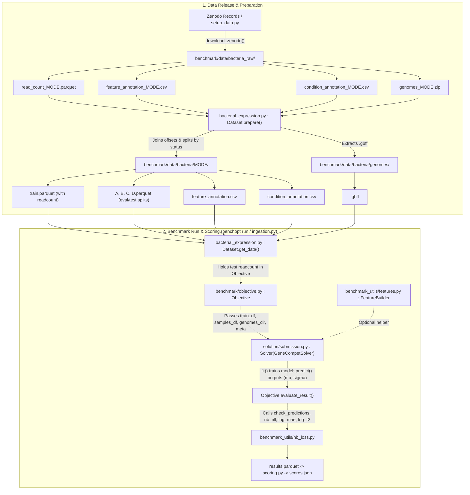

# Bacterial gene-expression competition (benchopt + Codabench)

A Codabench competition whose evaluation **is** a benchopt benchmark:
participants run the exact same code locally that the server runs. The task is
to predict RNA-seq expression `counts` for a gene × sample observation from its
genome sequence, gene description and experimental (environment) metadata, and
to **generalize to held-out bacterial species**.

See `gene_expression_getting_started.ipynb` for an end-to-end walkthrough.

## The benchmark (`benchmark/`)

The self-contained benchopt benchmark — run it directly with
`benchopt run benchmark`:

- `benchmark/objective.py` — the task + metric (Negative-Binomial NLL, MAE/R²)
  per region, on the public and hidden private halves; always trains.
- `benchmark/datasets/` — `simulated.py` (zero-dependency smoke test) and
  `bacterial_expression.py` (downloads the real data from Zenodo in
  `prepare` and writes its train / A / B / C / D regions).
- `benchmark/solvers/` — `constant.py` (floor), `baseline_nn.py` (NN),
  `baseline_catboost.py` (gradient boosting).
- `benchmark/benchmark_utils/` — the metric, the `GeneCompetSolver` submission
  contract, feature engineering, shared helpers.

## The competition wrapper (repo root)

- `competition.yaml` — the single-phase competition (public columns +
  hidden private columns).
- `ingestion_program/` — a thin `benchopt run` wrapper (runs the submission).
- `scoring_program/` — parses the benchopt results into `scores.json`.
- `phases/main/input_data/config.yaml` — the phase config (a native benchopt
  run config + a `scoring` column map).
- `pages/`, `solution/submission.py` — participant pages and the sample
  submission.
- `tools/` — `setup_data.py` (build the release), `Dockerfile`, `requirements.txt`,
  `create_bundle.py`, `run_docker.py`.

## Get the data

One command downloads all the public data from Zenodo, about 1.1 GB: the
train and eval counts, the gene and run annotations, and the genomes.

```bash
benchopt prepare benchmark -d "BacterialExpression[mode=train]"
```

The data goes to `benchmark/data/`, or to `$BENCHOPT_DATA_HOME`.
`mode=debug` downloads a small E. coli subset. The test counts stay on the
platform.

## Quickstart

```bash
pip install -r requirements.txt

# download the small subset, fit on train and score on the eval regions
benchopt prepare benchmark -d "BacterialExpression[mode=debug]"
benchopt run benchmark -d "BacterialExpression[mode=debug]" \
    -s solution/submission.py

# design-level tests + zero-dependency smoke test
benchopt test benchmark --skip-install
benchopt run benchmark -d Simulated -s Constant
```

## Build the Codabench bundle

```bash
python tools/create_bundle.py     # -> bundle.zip (upload to Codabench)
```

The bundle ships the config, programs, pages and the **benchmark** (in the
phase `input_data`, so a benchmark change needs no image rebuild). The
**data** (including the sealed private split) is staged separately onto the
compute worker at `$BENCHOPT_DATA_HOME` (`/app/data`), so it never enters the
public artifact.

---

# 1. Parameter Description

### The Big Picture: What is "Gene Expression"?
Think of a bacterial cell as a microscopic factory:
1. **DNA (The Static Library):** A long string of 4 chemical letters (`A`, `T`, `C`, `G`), typically organized into a circular chromosome of a few million letters. A **gene** (or **Coding Sequence, CDS**) is a specific recipe in this library (usually 300 to 3,000 letters long) that instructs the cell on how to build a specific protein.
2. **mRNA (The Photocopies):** To build a protein, an enzyme called *RNA polymerase* lands on the DNA right before a gene, reads the letters, and makes a temporary copy called **messenger RNA (mRNA)** (*transcription*).
3. **Proteins (The Workers):** The cell reads the mRNA copies to assemble proteins (*translation*).

**Why does this matter for Machine Learning?**
Every cell in a bacterial colony has the **exact same DNA recipes**, yet the cell behaves completely differently at $37^\circ\text{C}$ in rich broth versus when starving or under antibiotic attack. It adapts by changing **how many mRNA photocopies** it makes of each gene (**gene regulation**).
* **RNA-seq (`readcount` $y_{g,r}$):** Scientists break open the bacteria, collect all the mRNA molecules floating around, sequence them into short fragments called **reads**, and count how many reads match each gene $g$ in experiment $r$.
* **Higher `readcount` = more mRNA copies = the gene is strongly "switched on" (expressed).**

---

### Biological Meaning of the Dataset Parameters

#### A. Taxonomic & Genomic Hierarchy (`species`, `genome_id`, `feature_id`)
* **`species` (88 in dataset, e.g., `Escherichia_coli`):** The biological species name.
* **`genome_id` (243 in dataset, e.g., `GCF_000005845.2`):** The specific **strain** (subtype) of that species.
  * *Biological intuition:* Unlike humans (who share $99.9\%$ of their DNA), two bacteria of the **exact same species** can have wildly different genomes. For instance, harmless lab *E. coli* K-12 and food-poisoning *E. coli* O157:H7 differ by over $1,000$ genes. All strains of a species share essential survival genes (*core genome*), plus strain-specific bonus genes (*accessory genome*).
  * *ML impact (Sparsity):* An experiment performed on strain `GCF_000005845.2` only measures the $\sim 4,250$ genes present in that strain. In the global $(\text{Genes} \times \text{Runs})$ matrix, a gene missing from a strain is a **structural absence**—not to be confused with a gene that exists in the strain but has **`readcount = 0`** (switched off).
* **`feature_id` (e.g., `cds-NP_414542.1`):** The unique identifier of a quantified gene (coding sequence) within a given `genome_id`.

#### B. Genomic Context & DNA Coordinates (`Chr`, `Start`, `End`, `Strand`, `Length`, `homology`)
How does the cell know *when* and *how much* to transcribe a gene? The regulatory instructions are written in the DNA sequence ($S_g$) around the gene:
* **`Chr`:** Which DNA molecule (chromosome or plasmid/contig) the gene sits on (e.g., `NC_000913.3`).
* **`Start`, `End`, `Length`:** The 1-based character positions where the gene begins and ends on the DNA string, and its total length in base pairs (letters).
* **`Strand` (`+` or `-`):** DNA is a double helix with two complementary strands (`A` pairs with `T`, `C` pairs with `G`) that run in opposite directions:
  * If `Strand == "+"`, the gene is read left-to-right ($\text{Start} \to \text{End}$). The control region (**promoter**) is immediately **before `Start`**.
  * If `Strand == "-"`, the gene sits on the opposite strand and is read right-to-left ($\text{End} \to \text{Start}$). Its promoter is immediately **after `End`**, and the letters must be **reverse-complemented** (`A` $\leftrightarrow$ `T`, `C` $\leftrightarrow$ `G` and read backwards).
* **Promoter (Upstream Region):** The $\sim 50\text{–}200$ letters right before a gene where RNA polymerase and **transcription factors** (molecular on/off switches) bind. The letter composition (e.g., `A/T/G/C` frequencies, specific motifs) controls baseline gene expression.
* **Operons (Neighboring genes $< 30\text{ bp}$ apart):** Unlike human genes, bacteria group genes that work on the same task side-by-side (often separated by $<30$ letters on the same strand) under a **single shared promoter**. They are transcribed together onto one mRNA molecule, meaning genes in the same operon have strongly correlated expression.
* **`homology` (`ref_genome_id`, `ref_feature_id`):** Genes across different strains/species that evolved from a common ancestor and share $\ge 50\%$ sequence identity.
  * *Why Operons & Homology matter for the Split (Regions A, B, C, D):* To prevent data leakage, genes sharing $\ge 50\%$ sequence identity or sitting within $30\text{ bp}$ of each other (operons) are grouped into connected clusters and kept in the same split. Thus, a "new gene" in **Region C** or **D** is genuinely novel—not just a near-identical copy of a training gene.

#### C. Experimental Environment ($E_r$: `condition_annotation.csv` parameters)
These describe the physical and chemical environment of the bacteria during RNA-seq run `run_accession` (grouped by study `prj_accession` and experimental setup `experiment_accession`):
* **`is_wild_type` (`True`/`False`):** `True` means the natural, unedited bacterial strain; `False` means scientists genetically mutated/deleted a gene to see how the cell reacts.
* **`medium_category` & `medium_name`:** The nutrient broth ("food"). E.g., `complex_rich` (like LB broth, where amino acids are abundant so bacteria turn *off* synthesis genes) vs. `minimal_defined` (like glucose MOPS, where bacteria must build everything from scratch and turn *on* metabolic pathways).
* **`temperature_celsius` & `ph`:** Physical conditions; extremes trigger heat-shock, cold-shock, or acid-resistance genes.
* **`oxygen_condition` & `agitation_rpm`:** Whether oxygen is present (aerobic vs. anaerobic) and how fast the flask is shaken (`agitation_rpm`, which aerates the liquid). Bacteria completely rewire their energy production when oxygen drops.
* **`growth_mode`, `growth_phase`, `od600`:**
  * `growth_mode`: How they are cultured (e.g., `batch` flask vs. `chemostat_continuous` steady-state).
  * `growth_phase`: Bacteria in `exponential` (log) phase divide rapidly (high ribosome/growth gene expression); in `stationary` phase, nutrients are depleted and survival/stress genes turn on.
  * `od600`: Optical Density at $600\text{ nm}$—how cloudy the liquid culture is, measuring bacterial population density.
* **`has_perturbation`, `perturbation_category`, `perturbation_compound`:** Whether a chemical stressor or signal was added—for example, `hydrogen peroxide (H2O2)` causing `oxidative_or_nitrosative_stress`, or an antibiotic/inducer.

#### D. Technical Normalization Offsets (`log_length_ratio` $\ell_g$ and `log_size_factor` $q_r$)
Raw `readcount` is affected by two purely technical biases that have nothing to do with biology:
1. **`log_length_ratio` ($\ell_g$, gene-specific):** Because mRNA is chopped into short fragments before sequencing, a $3,000$-letter gene produces $10\times$ more fragments than a $300$-letter gene even if both have the exact same number of mRNA copies.
   $$\ell_g = \log(L_g) - \frac{1}{|\mathcal{G}_{h(g)}|}\sum_{j \in \mathcal{G}_{h(g)}} \log(L_j)$$
2. **`log_size_factor` ($q_r$, run-specific):** One sequencing machine run might sequence $50\text{ million}$ total fragments ("deep sequencing") while another sequences only $5\text{ million}$. Every gene in the first run will have $\sim 10\times$ higher counts. $q_r$ measures the run's sequencing depth relative to the median gene reference across runs.

Both enter your model as additive offsets on the log expected count:
$$\log \hat{\mu}_{g,r} = \eta_\theta(S_g, E_r) + \ell_g + q_r$$

#### E. Probabilistic Output: Predicting $(\mu, \sigma)$ for a Negative Binomial Distribution
RNA-seq read counts are discrete integers ($0, 1, 2, \dots$) with substantial **overdispersion** ($\operatorname{Var}(Y) > \mathbb{E}[Y]$). A deterministic point prediction cannot distinguish between a gene stably expressed at $100\pm 10$ reads and a noisy gene expressed at $100\pm 500$ reads. Therefore, for each observation, your model outputs two parameters `(mu, sigma)`:

* **`mu` ($\hat{\mu}_{g,r} \ge 0$):** The expected read count, $\mathbb{E}[Y_{g,r}] = \mu_{g,r}$.
* **`sigma` ($\hat{\sigma}_{g,r} > 0$):** Note that in this challenge, **`sigma` does not represent the standard deviation** as the notation $\sigma$ usually implies in statistics. Instead, `sigma` is the **Negative Binomial dispersion / concentration parameter** (often denoted $r$ or $1/\alpha$), which acts as a **"confidence" score** on the mean prediction.

Under this parameterization, the **true variance** of the Negative Binomial distribution is defined as:
$$\operatorname{Var}(Y_{g,r}) = \mu_{g,r} + \frac{\mu_{g,r}^2}{\sigma_{g,r}}$$

**How to interpret `sigma` as a confidence score:**
* **Small `sigma` ($\sigma_{g,r} \to 0^+$ = Low Confidence / High Uncertainty):** The quadratic overdispersion term $\frac{\mu_{g,r}^2}{\sigma_{g,r}}$ becomes very large, producing a wide, heavy-tailed distribution with high variance.
* **Large `sigma` ($\sigma_{g,r} \to +\infty$ = High Confidence / Low Uncertainty):** The overdispersion term $\frac{\mu_{g,r}^2}{\sigma_{g,r}} \to 0$, so the variance approaches the theoretical minimum for count data ($\operatorname{Var}(Y_{g,r}) \to \mu_{g,r}$), tightening into a concentrated, Poisson-like distribution.

---

# 2. Input Data Format & Pipeline Architecture (`benchmark/data`)

### Pipeline Flowchart: Scripts, Inputs, and Outputs



---

### Detailed Breakdown of the Files in `benchmark/data`

Inside `benchmark/data/`, there are two subdirectories managed by `Dataset.prepare()` in `benchmark/datasets/bacterial_expression.py`:
* `benchmark/data/bacteria_raw/`: Raw compressed files downloaded from Zenodo.
* `benchmark/data/bacteria/`: Prepared files organized under `<mode>/` (`debug/`, `train/`, or `full/`) plus the shared `genomes/` directory.

#### 1. The Read Count Files (`read_count_<mode>.parquet` $\to$ `{train, A, B, C, D}.parquet`)
* **Raw file (`benchmark/data/bacteria_raw/read_count_debug.parquet`):**
  Contains one row per **(gene $\times$ run)** observation with 6 columns:
  `species`, `genome_id`, `feature_id`, `run_accession`, `readcount`, and `status` (`Train`, `eval_A`, `eval_B`, `eval_C`, `eval_D`, or `test_*` in `full` mode).
* **Prepared files (`benchmark/data/bacteria/debug/{train, A, B, C, D}.parquet`):**
  During `prepare()`, `bacterial_expression.py` left-joins `log_length_ratio` (from `feature_annotation.csv`) and `log_size_factor` (from `condition_annotation.csv`) onto each observation, drops `status`, and writes separate Parquet files for training and for each evaluation region:

| Column | Type | Description | Present in `train_df`? | Present in `test_df` (A/B/C/D)? |
| :--- | :--- | :--- | :---: | :---: |
| `species` | category | Species name (e.g., `Escherichia_coli`) | Yes | Yes |
| `genome_id` | category | Strain genome ID (e.g., `GCF_000005845.2`) | Yes | Yes |
| `feature_id` | category | Gene ID (e.g., `cds-NP_414542.1`) | Yes | Yes |
| `run_accession` | category | RNA-seq run ID (e.g., `DRR351847`) | Yes | Yes |
| `log_length_ratio` | float64 | Gene length offset $\ell_g$ | Yes | Yes |
| `log_size_factor` | float64 | Run sequencing depth offset $q_r$ | Yes | Yes |
| `readcount` | float64 | **Target $y_{g,r}$** (raw RNA-seq count) | **Yes** | **No** (kept hidden by `Objective`) |

#### 2. The Annotation Files (`feature_annotation.csv` & `condition_annotation.csv`)

* **Gene Annotation Table (`benchmark/data/bacteria/debug/feature_annotation.csv`):**
  Contains one row per unique gene keyed by `["genome_id", "feature_id"]`:
  ```csv
  species,genome_id,feature_id,ref_genome_id,ref_feature_id,Chr,Start,End,Strand,Length,homology,on_contig_edge,log_length_ratio
  Escherichia_coli,GCF_000005845.2,cds-NP_414542.1,,,NC_000913.3,190,255,+,66.0,,False,-2.417750024521077
  Escherichia_coli,GCF_000005845.2,cds-NP_414543.1,,,NC_000913.3,337,2799,+,2463.0,,False,1.2017306315730352
  ```
  Provides the genomic coordinates (`Chr`, `Start`, `End`, `Strand`, `Length`) needed to slice the DNA sequence from the `.gbff` genome file, plus `on_contig_edge` (`True` if a gene sits at the boundary of an incomplete contig).

* **Condition (Run) Annotation Table (`benchmark/data/bacteria/debug/condition_annotation.csv`):**
  Contains one row per RNA-seq run keyed by `["genome_id", "run_accession"]`:
  ```csv
  species,genome_id,prj_accession,run_accession,log_size_factor,experiment_accession,condition_confidence,is_wild_type,medium_category,medium_name,temperature_celsius,ph,oxygen_condition,agitation_rpm,growth_mode,growth_phase,od600,has_perturbation,perturbation_category,perturbation_compound
  Escherichia_coli,GCF_000005845.2,PRJDB2960,DRR021392,-0.246515,DRX019545,medium,False,minimal_defined,glucose MOPS medium,,,,,chemostat_continuous,,,False,,
  ```
  *Note on missing values (`NaN`):* Because public RNA-seq metadata is often unrecorded by experimenters, unknown condition fields are left empty (`NaN`). Models using condition metadata should impute or handle missing values.

#### 3. The Genome Files (`benchmark/data/bacteria/genomes/<genome_id>.gbff`)
Unpacked from `genomes_debug.zip`, each `<genome_id>.gbff` file is a **GenBank Flat File** containing one or more sequence records (chromosomes/plasmids/contigs). Each record has 3 main sections:

1. **Header (`LOCUS` and `VERSION`):**
   ```text
   LOCUS       NC_000913            4641652 bp    DNA     circular CON 02-SEP-2026
   DEFINITION  Escherichia coli str. K-12 substr. MG1655, complete genome.
   VERSION     NC_000913.3
   ```
   The `Chr` column in `feature_annotation.csv` matches either `VERSION` (`NC_000913.3`, accessed as `record.id` in Biopython) or `LOCUS` (`NC_000913` / `contig_1`, accessed as `record.name` in Biopython).

2. **`FEATURES` Table:**
   ```text
        CDS             190..255
                        /gene="thrL"
                        /locus_tag="b0001"
                        /product="thr operon leader peptide"
                        /protein_id="NP_414542.1"
                        /translation="MKRISTTITTTITITTGNGAG"
   ```
   Contains annotated biological features including the gene name (`/gene`), protein product description (`/product`), enzyme commission numbers (`/EC_number`), and translated amino-acid sequence (`/translation`).

3. **`ORIGIN` (The Raw DNA Sequence):**
   At the bottom of the record, the complete DNA sequence is stored:
   ```text
   ORIGIN      
           1 agcttttcat tctgactgca acgggcaata tgtctctgtg tggattaaaa aaagagtgtc
          61 tgatagcagc ttctgaactg gttacctgcc gtgagtaaat taaaatttta ttgacttagg
         121 tcactaaata ctttaaccaa tataggcata gcgcacagac agataaaaat tacagagtac
         181 acaacatcca tgaaacgcat tagcaccacc attaccacca ccatcaccat taccacaggt
   ```
   For gene `cds-NP_414542.1` (`Start=190, End=255, Strand=+`), position `190` starts with `atgaaacgc...` (`atg` is the start codon), and positions `1..189` immediately upstream contain its promoter region.

---

# 3. Extracting Data for the Final Submission File (`solution/submission.py`)

A submission is a single self-contained Python file `submission.py` defining `class Solver(GeneCompetSolver)` (inheriting from `GeneCompetSolver` in `benchmark/benchmark_utils/base_solver.py`).

### The Submission Contract
1. **`get_model(self, meta)`:** Returns an untrained model instance. `meta` is a dictionary containing:
   * `meta["feature_annotations"]`: The `feature_annotation.csv` DataFrame.
   * `meta["condition_annotations"]`: The `condition_annotation.csv` DataFrame.
   * `meta["submission_dir"]`: Path to the submission folder (to load any shipped weights or precomputed tables).
   * Column lists: `id_features`, `numeric_features`, `gene_metadata_features`, `condition_metadata_features`.
2. **`fit(self, model, train_df, samples_df, genomes_dir)`:**
   * `train_df`: Training observations (`genome_id`, `feature_id`, `run_accession`, `log_length_ratio`, `log_size_factor`, `readcount`).
   * `samples_df`: The `condition_annotation.csv` DataFrame.
   * `genomes_dir`: `pathlib.Path` pointing to `benchmark/data/bacteria/genomes/`.
3. **`model.predict(test_df, samples_df, genomes_dir)`:**
   * Called on each held-out evaluation/test region (`A`, `B`, `C`, `D`).
   * Must return a NumPy array of shape `(len(test_df), 2)` with columns `[mu, sigma]` where `mu >= 0`, `sigma > 0`, and all entries are finite.

### Step-by-Step Data Extraction Recipe
Below is how the three data sources are extracted and joined (as implemented in `benchmark/benchmark_utils/features.py`):

```python
import numpy as np
import pandas as pd
from Bio import SeqIO
from benchmark_utils.base_solver import GeneCompetSolver

GENE_KEYS = ["genome_id", "feature_id"]
RUN_KEYS = ["genome_id", "run_accession"]

# 1. Extract DNA sequences (e.g., 200bp upstream promoter) from .gbff files
def extract_gene_sequences(genes_df: pd.DataFrame, genomes_dir, upstream: int = 200):
    promoters = pd.Series("", index=genes_df.index)
    if genomes_dir is None:
        return promoters

    for gid, group in genes_df.groupby("genome_id", observed=True):
        gbff_path = genomes_dir / f"{gid}.gbff"
        if not gbff_path.exists():
            continue
        # Index records by both VERSION (record.id) and LOCUS (record.name)
        records = {}
        for rec in SeqIO.parse(str(gbff_path), "genbank"):
            records[rec.id] = records[rec.name] = rec

        for idx, row in group.iterrows():
            chrom = str(row["Chr"]).split(";")[0]
            rec = records.get(chrom)
            if rec is None:
                continue
            # GenBank Start/End are 1-based; Python slices are 0-based
            start = int(str(row["Start"]).split(";")[0])
            end = int(str(row["End"]).split(";")[-1])
            strand = str(row["Strand"]).split(";")[0]

            if strand == "+":
                seq = rec.seq[max(0, start - 1 - upstream) : start - 1]
            else:
                seq = rec.seq[end : end + upstream].reverse_complement()
            promoters.loc[idx] = str(seq).upper()
    return promoters

# 2. Join observations with Gene Annotations & Condition Annotations
def assemble_features(obs_df: pd.DataFrame, genes_df: pd.DataFrame, samples_df: pd.DataFrame):
    # Left-join gene table on (genome_id, feature_id)
    gene_cols = GENE_KEYS + [c for c in genes_df.columns if c not in obs_df.columns]
    df = obs_df.merge(genes_df[gene_cols], on=GENE_KEYS, how="left")

    # Left-join condition table on (genome_id, run_accession)
    if samples_df is not None:
        run_cols = RUN_KEYS + [c for c in samples_df.columns if c not in df.columns]
        df = df.merge(samples_df[run_cols], on=RUN_KEYS, how="left")
    return df
```
You can also directly import and use `from benchmark_utils.features import FeatureBuilder` inside your solver (see `benchmark/solvers/baseline_nn.py`).

---

# 4. Running a Test (Debug Mode) with `benchopt`

All commands below should be run from your repository root.

```bash
pip install -r requirements.txt
```

### Step 1: Prepare the `debug` Dataset
```bash
benchopt prepare benchmark -d "BacterialExpression[mode=debug]"
```
* **What happens:** `Dataset.prepare()` checks `benchmark/data/bacteria_raw/` (downloading any missing `_debug` files from Zenodo—only 1 genome `GCF_000005845.2` instead of the full 750 MB archive), attaches the normalization offsets, and writes `train.parquet`, `A.parquet`, `B.parquet`, `C.parquet`, `D.parquet`, `feature_annotation.csv`, and `condition_annotation.csv` into `benchmark/data/bacteria/debug/`.
* *(Note: If you have already run `benchopt prepare` previously, the prepared files are already on disk; if you ever need to regenerate them, append `--force`.)*

### Step 2: Run Your Submission in Debug Mode
To test `solution/submission.py` on the `debug` split with full error tracebacks enabled:
```bash
BENCHOPT_DEBUG=true benchopt run benchmark \
    -d "BacterialExpression[mode=debug]" \
    -s solution/submission.py \
    --no-cache --no-plot
```
* **`BENCHOPT_DEBUG=true`:** Forces `benchopt` to immediately raise and print any Python traceback if your solver crashes (the exact same setting used on the Codabench evaluation server in `ingestion_program/ingestion.py`).
* **`--no-cache`:** Ensures `benchopt` re-runs your code fresh every time you edit `submission.py`.
* **What it outputs:** `benchopt` fits your model on `train.parquet` and prints the evaluation metrics computed by `Objective.evaluate_result()`:
  * `objective_nb_nll_A`, `objective_nb_nll_B`, `objective_nb_nll_C`, `objective_nb_nll_D` (alongside `mae_*` and `r2_*` on `log1p(counts)`)
  * `objective_nb_nll_challenge` (the primary ranking score: equal average of NB-NLL across regions **A, B, and C**).

### Step 3: Compare Against Built-in Baselines or Run Smoke Tests
* **Compare your submission against the built-in baselines** (`Constant`, `BaselineCatBoost`, `BaselineNN`):
  ```bash
  benchopt run benchmark -d "BacterialExpression[mode=debug]" \
      -s Constant -s BaselineCatBoost -s BaselineNN -s solution/submission.py
  ```
* **Fast zero-dependency synthetic smoke test:**
  Uses the `Simulated` dataset to verify that your solver's output shapes and API contract are valid without loading real genomic data:
  ```bash
  BENCHOPT_DEBUG=true benchopt run benchmark -d Simulated -s solution/submission.py --no-cache
  ```
* **Run the benchmark test suite:**
  ```bash
  benchopt test benchmark --skip-install
  ```
