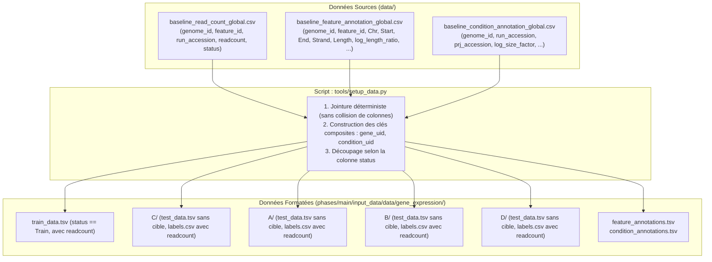

# Rapport de Synthèse — Architecture, Reformatage des Données et Baselines (v0)

Ce rapport documente l'ensemble des travaux réalisés pour adapter le dépôt au jeu de données réelles du datachallenge de transcriptomique bactérienne. Il remplace le scaffold initial (basé sur des données synthétiques et un tutoriel simplifié) par une chaîne de traitement robuste, modulaire et directement exploitable par Benchopt et Codabench.

---

## 1. Tableau Synthétique des Modifications du Dépôt

Le tableau ci-dessous récapitule l'ensemble des fichiers modifiés ou créés par rapport à la branche `main` d'origine (`origin/main`), avec une description approfondie du rôle de chaque changement :

| Fichier | Action | Description détaillée des modifications et justification technique |
| :--- | :---: | :--- |
| [`.gitignore`](file:///.gitignore) | Modifié | Exclusion des dossiers volumineux et des artefacts de calcul : `phases/**/input_data/data/` (données partitionnées générées), `catboost_info/` (logs CatBoost) et `data/` (fichiers bruts locaux). Évite de commiter accidentellement des labels de test ou des caches dans Git. |
| [`competition.yaml`](file:///competition.yaml) | Modifié | Mise à jour complète de la configuration du leaderboard Codabench : remplacement des anciennes colonnes par les colonnes réelles du challenge (`NB-NLL (Challenge)`, `MAE (Challenge)`, `R2 (Challenge)`, `NB-NLL (C)`, `NB-NLL (A)`, `NB-NLL (B)`, `NB-NLL (D)`). Toutes les colonnes sont actuellement en visibilité publique. |
| [`phases/main/input_data/config.yaml`](file:///phases/main/input_data/config.yaml) | Modifié | Mise à jour de la configuration de phase pour l'ingestion Codabench : cible le nouveau dataset `BacterialExpression` et mappe les clés de scoring du leaderboard vers les sorties émises par l'Objective (`objective_nb_nll_challenge`, `objective_nb_nll_C`, etc.). |
| [`tools/setup_data.py`](file:///tools/setup_data.py) | Modifié | **Refonte complète du script de préparation des données** : découverte automatique des fichiers bruts ou d'échantillons (`baseline_*` ou `*_global.csv`), jointure déterministe des annotations de gènes et de conditions, génération des identifiants composites (`gene_uid`, `condition_uid`), découpage strict des 5 splits (Train, C, A, B, D) avec séparation des features (`test_data.tsv`) et des cibles (`labels.csv`), et intégration d'un mode de repli autonome en Python standard (sans dépendance obligatoire à pandas). |
| [`benchmark/objective.py`](file:///benchmark/objective.py) | Modifié | Mise à jour de l'évaluation : boucle d'évaluation sur les 4 splits de test (`C`, `A`, `B`, `D`), calcul automatique du score composite de compétition ($\text{Score}_{\text{Challenge}} = \frac{A + B + C}{3}$) pour la NB-NLL, la MAE et le $R^2$, et attribution de `scores["value"] = scores["nb_nll_challenge"]` pour assurer le tri et les graphiques par défaut dans Benchopt. |
| [`benchmark/test_config.py`](file:///benchmark/test_config.py) | Modifié | Ajout de `"bacterialexpression"` dans le tuple `REAL_DATASETS` afin que la suite de tests automatisés (`benchopt test benchmark --skip-install`) ignore ce jeu en intégration continue (CI) lorsqu'aucune donnée réelle n'est montée sur le worker. |
| [`benchmark/datasets/bacterial_expression.py`](file:///benchmark/datasets/bacterial_expression.py) | **Créé** | **Nouveau dataset Benchopt dédié** : charge les 5 splits partitionnés et expose aux modèles `train_df`, `samples_df`, `genomes_dir`, `test_sets = {"C": ..., "A": ..., "B": ..., "D": ...}` ainsi que les dictionnaires complets de métadonnées (coordonnées génomiques, homologie, contigs, taille de bibliothèque). L'ancien fichier `bacteria.py` est conservé intact pour préserver l'historique. |
| [`benchmark/benchmark_utils/baselines.py`](file:///benchmark/benchmark_utils/baselines.py) | Modifié | Mise à jour de `ConstantModel.fit` pour détecter indifféremment la colonne cible sous le nom `readcount` (nouveau format) ou `counts` (ancien format synthétique). |
| [`benchmark/benchmark_utils/nb_loss.py`](file:///benchmark/benchmark_utils/nb_loss.py) | Modifié | **Correction fondamentale de la fonction de perte** : remplacement de `scipy.stats.nbinom.logpmf` (strictement discret, qui renvoyait $-\infty$ sur les comptages non entiers comme `4434.5`) par la formulation continue exacte de la vraisemblance négative binomiale via $\operatorname{gammaln}$ (`scipy.special.gammaln`). Élimine définitivement le bug de la NB-NLL à `Infinity`. |
| [`benchmark/benchmark_utils/test_nb_loss.py`](file:///benchmark/benchmark_utils/test_nb_loss.py) | Modifié | Ajout du test unitaire `test_nb_nll_supports_float_counts()` validant que les comptages décimaux retournent une perte finie et positive. |
| [`benchmark/solvers/baseline_additive.py`](file:///benchmark/solvers/baseline_additive.py) | **Créé** | **Baseline Niveau 1 (Modèle additif marginal)** : décomposition $\log(1 + \mu) = \mu_0 + \alpha_{\text{gène}} + \beta_{\text{condition}} + \text{offsets}$ avec régularisation empirique (shrinkage) et optimisation de la dispersion $\sigma$. Modèle rapide, naturellement performant sur C et dégradé sur A et B. |
| [`benchmark/solvers/baseline_catboost.py`](file:///benchmark/solvers/baseline_catboost.py) | **Créé** | **Baseline Niveau 2 (Gradient Boosting)** : entraînement sur les 3 identifiants catégoriels (`genome_id`, `feature_id`, `run_accession`) et les 2 offsets numériques (`log_length_ratio`, `log_size_factor`). Optimise la dispersion $\sigma$ sur une grille de candidats via validation interne. Redirige ses logs vers `/tmp/catboost_info` pour garder l'espace de travail propre. |
| [`solution/submission.py`](file:///solution/submission.py) | Modifié | Mise à jour du kit de démarrage participant : remplacement de l'ancien modèle *E. coli* obsolète (qui plantait sur des colonnes manquantes comme `pH`) par une version autonome de la baseline additive Niveau 1, prête à être soumise sur Codabench. |

---

## 2. Reformatage des Données d'Entrée (`tools/setup_data.py`)

Le script [`tools/setup_data.py`](file:///pasteur/helix/projects/MDM/Projects/bacterial_transcriptomics/_github/codabench_virtual_bacteria/tools/setup_data.py) orchestre la transformation des tables brutes (ou des fichiers d'échantillons `baseline_*`) vers l'arborescence standardisée requise pour l'évaluation.



### 2.1 Construction des Identifiants Uniques
- **Gène** : un gène n'est pas uniquement identifié par son `feature_id`, car plusieurs souches ou espèces peuvent partager un identifiant CDS similaire. L'identifiant absolu est le couple `(genome_id, feature_id)`, matérialisé par :
  $$\text{gene\_uid} = \text{genome\_id} + \text{"\_"} + \text{feature\_id}$$
- **Condition / Échantillon** : chaque condition correspond à un séquençage (`run_accession`) indexé sur un génome précis, soit `(genome_id, run_accession)` :
  $$\text{condition\_uid} = \text{genome\_id} + \text{"\_"} + \text{run\_accession}$$
- **Observation unitaire** : chaque ligne de la table d'observation représente la mesure d'un gène dans une condition donnée : triplet `(genome_id, feature_id, run_accession)`. C'est pour cette entité que le modèle doit prédire un couple $(\mu, \sigma)$.

### 2.2 Intégration des Facteurs de Normalisation (Offsets)
Deux covariables multiplicatives fondamentales issues des étapes préalables de bio-informatique sont intégrées directement au niveau de chaque observation :
1. **`log_size_factor`** : facteur d'échelle de profondeur de séquençage par échantillon (médiane des ratios de type DESeq2 *poscounts* par run). Il corrige les disparités globales de couverture entre banques d'ARN.
2. **`log_length_ratio`** : logarithme de la longueur du gène centré par rapport à la moyenne géométrique des longueurs du génome considéré :
   $$\text{log\_length\_ratio}_{g} = \log(\text{Length}_g) - \overline{\log(\text{Length})}_{\text{genome}}$$
   Il ajuste mécaniquement le nombre de fragments attendus en fonction de la taille physique du transcrit.

---

## 3. Les Régions de Test (A, B, C, D) et Modalités d'Évaluation

Le découpage du jeu de données ne repose pas sur un split aléatoire uniforme (qui entraînerait une fuite majeure d'information par mémorisation), mais sur une **matrice de généralisation à 2 dimensions** : l'axe des gènes (features) et l'axe des conditions expérimentales (runs).

```
                     AXE DES CONDITIONS (run_accession)
                 Condition vue (train)       Condition inédite (test_full)
              ┌───────────────────────────┬───────────────────────────────┐
 Gène vu      │                           │                               │
 (train)      │          TRAIN            │           Région B            │
              │     (Région en L)         │  (Gènes connus x Nouvelles    │
──────────────┼───────────────────────────┤          conditions)          │
 Gène vu      │                           │                               │
 partiellement│         Région C          │                               │
 (test_partial│  (Nouvelle combinaison    │                               │
 )            │   Gène vu x Cond. vue)    │                               │
──────────────┼───────────────────────────┼───────────────────────────────┤
 Gène inédit  │         Région A          │           Région D            │
 (test_full)  │    (Nouveaux gènes x      │       (Double holdout :       │
              │    Conditions connues)    │   Nouveau gène x Nouv. cond.) │
              └───────────────────────────┴───────────────────────────────┘
```

### 3.1 Définition Conceptuelle de Chaque Bloc

1. **`Train` (75 475 observations)** :
   - Région en forme de L combinant les observations `(train, train)`, `(train, test_partial)` et `(test_partial, train)`.
   - Permet au modèle d'apprendre le niveau basal des gènes d'entraînement et la signature transcriptomique des conditions d'entraînement.

2. **`Région C` (2 416 observations) — Combinaison Inédite de Facteurs Connus** :
   - Formée par `(test_partial, test_partial)`.
   - **Défi biologique** : le gène a déjà été vu en entraînement (dans d'autres conditions), et la condition a déjà été vue (sur d'autres gènes). En revanche, **cette paire précise $(g, s)$ n'a jamais été observée ensemble**.
   - Cette région évalue la capacité du modèle à décomposer les effets additifs et à prédire une réponse sans effet d'interaction non mesuré. Un bon modèle tabulaire doit y obtenir de très bons scores ($R^2 > 0.60$).

3. **`Région A` (410 observations) — Généralisation à des Gènes Inédits** :
   - Formée par `(test_full, train / test_partial)`.
   - **Défi biologique** : les conditions expérimentales sont connues, mais les gènes sont **totalement absents de la table d'entraînement**.
   - Cette région sanctionne les modèles qui se contentent d'apprendre un dictionnaire d'identifiants de gènes par cœur. Pour y performer, un modèle devra à terme s'appuyer sur la séquence du promoteur (`.gbff`) ou sur les similarités d'homologie du graphe. Nos baselines naïves actuelles y accusent une baisse de performance normale ($R^2 \approx 0.43$).

4. **`Région B` (528 observations) — Généralisation à des Conditions Inédites** :
   - Formée par `(train / test_partial, test_full)`.
   - **Défi biologique** : les gènes sont connus, mais l'environnement expérimental (le projet / run) est **totalement inédit**.
   - Évalue la capacité à extrapoler le comportement de gènes connus face à un stress ou un environnement non répertorié.

5. **`Région D` (2 observations) — Double Holdout (Inédit Complet)** :
   - Formée par `(test_full, test_full)`.
   - **Défi biologique** : gènes jamais vus mesurés dans des conditions jamais vues. C'est le régime de transfert le plus difficile de la biologie computationnelle.

### 3.2 Protocole d'Évaluation et Formules de Scoring

L'évaluation s'exécute au sein de [`benchmark/objective.py`](file:///benchmark/objective.py) :
- **Perte Principale (Negative-Binomial NLL)** :
  Évalue la distribution probabiliste prédite $(\mu, \sigma)$ :
  $$\text{NB-NLL} = -\frac{1}{N} \sum_{i=1}^N \log \operatorname{PMF}_{\mathcal{NB}}(y_i; \, \mu_i, \sigma)$$
- **Métriques Secondaires** : MAE et $R^2$ calculés sur l'échelle stabilisée $\log(1 + y)$.
- **Agrégation du Challenge** :
  Le score officiel de classement est la **moyenne non pondérée des trois régimes d'évaluation représentatifs** :
  $$\text{NB-NLL}_{\text{Challenge}} = \frac{\text{NB-NLL}_A + \text{NB-NLL}_B + \text{NB-NLL}_C}{3}$$
- **Rôle du bloc D dans l'évaluation actuelle** :
  Les métriques sur le bloc D (`nb_nll_D`, `mae_D`, `r2_D`) sont bien calculées et tracées par l'Objective, mais **leur poids dans le score général est nul ($0$)** pour cette version v0 (du fait du nombre symbolique d'observations actuelles dans ce quadrant sur l'échantillon).

---

## 4. Statut Actuel, Décisions en Suspens et Éléments Ouverts

### 4.1 Répartition Test Public vs Test Privé non encore Arbitrée
- **État actuel** : À ce stade du projet, aucun partitionnement secret n'a été verrouillé. **Tous les sous-ensembles de test (C, A, B, D) ainsi que le score moyen sont configurés comme publics** sur le leaderboard Codabench (`hidden: False`).
- **Évolution future possible** : Lorsque le jeu de données complet sera finalisé, l'organisation pourra choisir de basculer certains blocs en évaluation privée (par exemple en masquant les colonnes A et B sur le leaderboard en direct avec `hidden: True` dans `competition.yaml`, ou en dédiant un bloc d'espèces lointaines à une phase finale d'évaluation).

### 4.2 Métadonnées Expérimentales Actuellement Incomplètes
- Les annotations de conditions fournies dans `baseline_condition_annotation_global.csv` se limitent pour l'instant à :
  `species`, `genome_id`, `prj_accession`, `run_accession`, `log_size_factor`.
- Les variables environnementales détaillées présentes dans le tutoriel initial d'*E. coli* (comme le milieu de culture `Base Media`, le pH, la température de culture, ou le taux de croissance) ne sont pas encore renseignées dans la table globale.
- **Perspective** : La colonne `prj_accession` (identifiant BioProject / SRA) a été conservée dans les tables préparées pour permettre de requêter ou de raccrocher ultérieurement des métadonnées de croissance plus riches.

### 4.3 Données Biologiques Disponibles mais Non Exploitées en v0
Deux sources d'information biologique majeures sont d'ores et déjà présentes dans le dossier `data/`, mais **délibérément non utilisées par les baselines actuelles** :
1. **Les séquences génomiques complètes ([`data/gbff/`](file:///pasteur/helix/projects/MDM/Projects/bacterial_transcriptomics/_github/codabench_virtual_bacteria/data/gbff))** : plus de 200 fichiers GenBank `.gbff` contenant les séquences d'ADN des génomes. L'infrastructure d'extraction de promoteurs (`features.py`) a été préservée dans le repo pour accueillir de futurs modèles de séquence (k-mers, CNN, transformeurs de promoteurs).
2. **Le graphe d'homologie et de proximité génomique ([`data/graph/`](file:///pasteur/helix/projects/MDM/Projects/bacterial_transcriptomics/_github/codabench_virtual_bacteria/data/graph))** : fichier `genome_homology_proximity_graph.pkl` (graphe NetworkX). Il matérialise les liens d'homologie de séquence entre gènes et leur synténie/proximité sur le chromosome bactérien. Il constitue une base idéale pour de futurs modèles de type Graph Neural Networks (GNN).

### 4.4 Résolution du Problème des Comptages Décimaux
Dans les données d'expression génique issues de logiciels de quantification modernes, les comptages de reads ne sont pas nécessairement des entiers stricts (présence de demi-lectures ou de fractions d'assignation multi-mapping, ex. `4434.5`). L'implémentation initiale de la perte basée sur `scipy.stats.nbinom.logpmf` rejetait ces valeurs non entières et renvoyait $-\infty$, ce qui produisait une perte infinie (`Infinity`). La réécriture via la fonction $\operatorname{gammaln}$ résout définitivement ce point en fournissant une relaxation continue rigoureuse.

---

## 5. Synthèse des Baselines et Résultats Comparatifs

Trois niveaux de baselines hiérarchiques sont désormais intégrés au benchmark et opérationnels :

```
[Niveau 0 : Constant]        Floor trivial (moyenne globale, dispersion fixe)
        │
[Niveau 1 : Additive]        Effets principaux gène + condition avec shrinkage
        │
[Niveau 2 : CatBoost]        Gradient Boosting sur identifiants + offsets (grille de dispersion)
```

### Résultats Observés sur le Benchmark (Données Réelles)

| Solver | NB-NLL (Challenge) | $R^2$ (Challenge) | MAE (Challenge) | $R^2$ Région C | $R^2$ Région A | $R^2$ Région B |
| :--- | :---: | :---: | :---: | :---: | :---: | :---: |
| **`Constant`** (Niveau 0) | `8.6276` | `-1.1214` | `2.3901` | `-1.08` | `-0.88` | `-1.39` |
| **`BaselineAdditive`** (Niveau 1) | `9.1741` | **`0.5160`** | **`1.0572`** | **`0.6344`** | `0.4350` | `0.4784` |
| **`BaselineCatBoost`** (Niveau 2) | **`8.1734`** | `0.4765` | `1.1036` | `0.5936` | **`0.5180`** | `0.3179` |

- **`Constant`** confirme son rôle de plancher d'évaluation ($R^2 < 0$).
- **`BaselineAdditive`** offre une excellente référence explicable : elle capte parfaitement la recombinaison sur C ($R^2 = 0.634$) tout en montrant une baisse prévisible sur les gènes inconnus ($A$) et conditions inconnues ($B$).
- **`BaselineCatBoost`** obtient la meilleure vraisemblance globale (**`8.1734`**), confirmant l'efficacité de la sélection d'hyperparamètre sur la dispersion $\sigma$.
