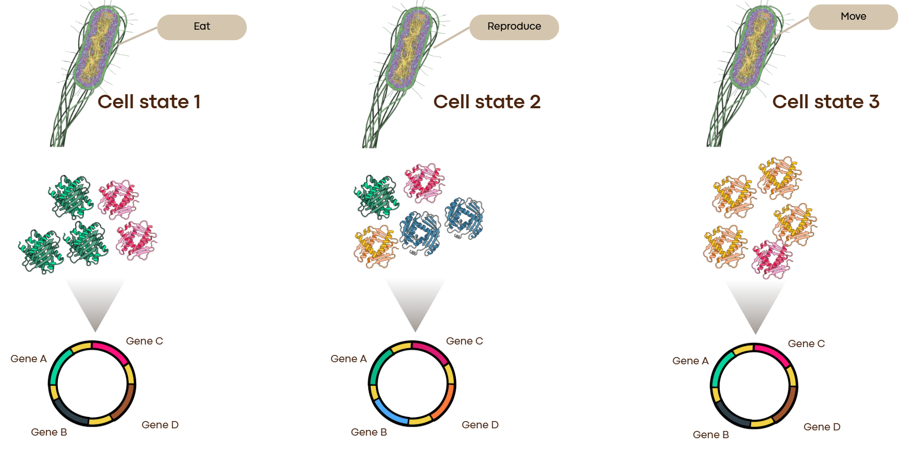

# Bacterial Transcriptomics

Reading time : **~30min** 

Datachallenge biological background and implementation detail

Glossary for biologic terms : https://www.genome.gov/genetics-glossary 

# 1. Scientific Background and Motivation

### 1.1. Gene Expression as a Fundamental Process of Bacterial Adaptation

Gene expression is a central mechanism for regulating cellular functions in bacteria. It allows a cell to adjust its biological activity based on its physiological state, its environment, and the constraints to which it is subjected.

 

In bacteria, variations in gene expression play a key role in adaptation to changes in temperature, pH, nutrient availability, culture medium composition, growth phase, and stress conditions. These factors influence transcriptional activity and, consequently, the abundance of transcripts associated with different genes.

Let’s look deeper into the mechanism behind protein production. 

The **Central Dogma** of molecular biology states that DNA is **transcribed** into messenger RNA (mRNA). During transcription, an enzyme called RNA polymerase binds to a specific sequence right before the gene—called the **promoter**—and moves along the DNA to produce an mRNA copy of the gene. This mRNA is then **translated** into protein. Crucially, the number of mRNA copies defines the amount of protein produced. What’s interesting for us is that the number of copies of the exact same gene varies drastically depending on the environment. That is what we call **gene regulation**.

**To go further :**
 https://www.youtube.com/watch?v=TatNfCyQ52Q
https://www.khanacademy.org/science/ap-biology/gene-expression-and-regulation/translation/a/intro-to-gene-expression-central-dogma?referrer=share_link  : Central dogma in detail 

### 1.2 What are the variables that define gene regulation

Gene regulation depends on several biologically complementary sources of information. 

#### Genomic context (DNA)

The first is the **genomic context**, which includes :

- **Coding Sequence (CDS):** The actual body of the gene that gets transcribed into mRNA and translated into protein.
- **Upstream Region (Before the Gene):** Contains the **promoter** (where RNA polymerase lands), recognition motifs for **sigma factors** (helper proteins that guide RNA polymerase to specific promoters under stress or normal growth), and binding sites for **transcription factors** (proteins that act like molecular switches, either activating or blocking transcription).
- **Operons (A Key Bacterial Feature):** Unlike human genes, which are usually transcribed one by one, bacteria frequently group multiple related genes side-by-side on the DNA (often separated by fewer than $30$ letters) under the control of a **single shared promoter**. When switched on, the entire cluster—called an **operon**—is transcribed together onto one single mRNA molecule. Consequently, genes inside the same operon tend to have strongly correlated expression levels.

 

**To go further**

https://vimeo.com/518275997?fl=pl&fe=sh

https://youtu.be/Xwk6qrcqiMc?si=8E-QQQ9npUnOJsbt

#### Environment (experimental condition)

Second source of information is **the cell’s physiological and environmental state**. The presence of certain nutrients, the activation of metabolic pathways, or exposure to stress can alter the activity of numerous regulators and lead to coordinated changes in gene expression.

The measured expression of a gene thus results from the interaction between its genomic context, and the biological state, the environment  in which it is observed. 

*⇒* The development of models capable of integrating these different sources of information is therefore a major challenge in bioinformatics and computational biology.

### 1.2. The Contribution of RNA-seq Data

RNA sequencing (RNA-seq) makes it possible to characterize the abundance of **transcripts** present in a biological sample. After aligning the reads to a reference genome and quantifying the reads associated with the various annotated features, it is possible to obtain an expression measure for each gene or genomic sequence under consideration. 

The accumulation of RNA-seq data from a large number of experiments provides an opportunity to uncover the relationships between genomic characteristics and observed expression levels.

Indeed, each experiment provides a set of measurements corresponding to the expression of numerous genes in a specific biological context. Repeating these observations across different conditions, strains, and species makes it possible to identify common patterns.

 However, the joint analysis of these data raises several challenges:

- the experiments do not necessarily involve the same species or the same strains;
- gene repertoires differ across genomes;
- the metadata describing experimental conditions is often **incomplete** or **inconsistent**;
- read counts depend on both transcript abundance and technical factors (see in section 2)

**To go further :** 

https://www.genome.gov/genetics-glossary/RNA-seq

### **1.3. The Diversity of Bacterial Genomes: From Domain to Species and Strains**

To understand why our dataset contains **88 species** but **243 distinct reference genomes**, it is essential to distinguish three hierarchical levels of biological organization: **Bacteria**, **Species**, and **Strains**.

**The Domain — Bacteria:**
Bacteria are single-celled microorganisms that lack a cell nucleus (prokaryotes). Their genetic blueprint is typically stored in a single circular chromosome of a few million letters (base pairs, `A, T, C, G`), organized into thousands of genes.

**The Species (88 in our dataset):**
Within the bacterial domain, organisms are grouped into **species** based on their shared evolutionary history, lifestyle, and core metabolic capabilities. Famous bacterial species include:
    ◦ *Escherichia coli* (*E. coli*): a common inhabitant of the human gut and the most widely studied model organism in microbiology;
    ◦ *Staphylococcus aureus*: a bacterium frequently found on the skin that can cause severe hospital-acquired infections;
    ◦ *Pseudomonas aeruginosa*: a versatile environmental bacterium capable of colonizing lungs and resisting multiple antibiotics;
    ◦ *Bacillus subtilis*: a harmless soil bacterium widely used in industrial biotechnology.

**The Strain (243 genomes in our dataset):**
Unlike humans—where any two individuals share over 99.9% of their DNA—two bacteria belonging to the **exact same species** can have vastly different genomes. A specific genetic variant or subtype within a species is called a **strain**.
Take *Escherichia coli* as an example:
    ◦ ***E. coli* K-12 MG1655** is a harmless laboratory strain with roughly 4,300 genes.
    ◦ ***E. coli* Nissle 1917** is a beneficial probiotic strain used in medicine.
    ◦ ***E. coli* O157:H7** is a dangerous food-poisoning strain whose genome contains **over 1,000 extra genes** not found in K-12, including genes that produce lethal toxins.

**Why does this hierarchy matter for our machine learning problem?**
Within a single species, all strains share a set of essential housekeeping genes (the *core genome*), but each strain also carries its own unique set of extra genes acquired through evolution (the *accessory genome*). Because each RNA-seq experiment is performed on one specific **strain** (one of the 243 reference genomes), **gene repertoires differ across genomes**. This would lead as a highly sparse data structure that we will see in section 2. 

**Conclusion :**

The project aims to leverage this diversity to develop a model capable of quantitatively predicting the expression of a gene in a given experiment, while evaluating its ability to generalize to genes and experiments never observed during training.

---

# 2. Presentation and Structure of the Dataset

### 2.1. A Large-Scale Transcriptomic Collection

The project is based on a collection of approximately 19,500 RNA-seq experiments, covering 88 bacterial species and 243 distinct reference genomes. 

Each strain has, on average, approximately **3,500 annotated genes** (=features). The collection thus comprises approximately 880,000 gene (=feature) identifiers, for a total of approximately **78 million** observations.

The main orders of magnitude are summarized below.

| Level | Entity | Order of magnitude |
| --- | --- | --- |
| Taxonomic diversity | Bacterial species | 88 |
| Genomic diversity | Reference genomes | 243 |
| Experimental diversity | RNA-seq runs | 19,500 |
| Genomic repertoire | Gene identifiers or features | 880,000 |
| Expression observations | Gene–experiment pairs | 78 million |

It is important to distinguish between **gene identifiers (=feature_id)** and **biologically distinct sequences**. Two identifiers from different strains/genome may correspond to identical sequences. 

### 2.2. Definition of an Observation

The basic unit of learning is the pair consisting of a gene (= feature) and an experiment (=condition=run). Each observation associates:

- a gene $(g)$, defined by a unique identifier, and its position in the strain genome;
- an experiment $(r)$, corresponding to an RNA-seq sample, a run ((biological sample under a given condition);
- an observed read count $(y_{g,r})$, representing the number (**discrete non-negative integer** $y_{g,r} \in \{0, 1, 2, \dots\}$ ) of reads assigned to the gene  $(g)$ in this experiment  $(r)$. Reminder : read count = gene expression level ≈ number of protein produced
- The dataset can be represented as:

$$
\{(g,r,y_{g,r})\}
$$

The observed target remains the raw read count, but the model predicts a probability distribution rather than a single count. For each gene–experiment pair, it estimates the mean and the dispersion / concentration parameter (interpreted as a confidence score) of a negative binomial distribution:

$$
(\hat{\mu}_{g,r},\hat{\sigma}_{g,r})=f_{\theta}(S_g,E_r)
$$

with:

$$
Y_{g,r}\mid S_g,E_r\sim\operatorname{NB}(\hat{\mu}_{g,r},\hat{\sigma}_{g,r})
$$

where:

- $S_g$ represents a single genomic input: the nucleotide sequence of the gene together with its surrounding sequence, including the relevant upstream and downstream regions;
- $E_r$ represents the experimental information available for run $r$, including condition metadata and, when available, a partial transcriptomic representation;
- $f_\theta$ is the predictive model;
- $\hat{\mu}_{g,r}$ is the predicted expected read count ($\hat{\mu}_{g,r} \ge 0$);
- $\hat{\sigma}_{g,r}$ is the predicted Negative Binomial dispersion / concentration parameter ($\hat{\sigma}_{g,r} > 0$), acting as a confidence score rather than the classical standard deviation.

The target used for training remains the observed raw count $y_{g,r}$. The model output is the pair $(\hat{\mu}_{g,r},\hat{\sigma}_{g,r})$, which defines the full predictive distribution. Auxiliary variables will help the model account for gene-length and experiment-level technical scaling.

### 2.3. A Highly Sparse Data Structure

Although the dataset comprises approximately 78 million observations, not all possible combinations of genes and experiments are observed. A given experiment involves a single bacterial strain and therefore concerns only the features present in the corresponding reference genome. Conversely, a given gene is measured only in a subset of the experiments. A global matrix representation of expression can be conceptually defined as:

$$
\mathbf{Y}\in\mathbb{R}^{G\times R}
$$

where $G$ corresponds to the number of gene identifiers and $R$ to the number of experiments. However, this matrix contains many combinations that are structurally impossible or unobserved. We must therefore distinguish between:

1. **A zero read count**: the gene is included in the quantification scope, but no reads have been assigned to it.
2. **A structural absence**: the gene does not exist in the reference genome of the studied strain or is not part of its feature set.
3. **Missing data**: the expected value is not available for technical or methodological reasons.

These situations must not be confused. In particular, a feature absent from the genome must not be equated with a gene that is present but not expressed. This distinction is fundamental for constructing the training data, calculating transcriptomic representations, and correctly evaluating the model.

### 2.4. Auxiliary Variables, Normalization, and Mean Offsets

The target remains the **raw read count**, while two log-scale annotations account for technical effects that systematically change its expected magnitude:

- The *log length ratio* $(\ell_g)$ is gene-specific. Longer quantified features can accumulate more reads simply because they provide a larger sequence target. This term represents the gene-length bias.
- The *log size factor* $(q_r)$ is run-specific. A run with a larger effective library size or sequencing depth tends to produce larger counts across many genes. This term represents the experiment-level technical scaling bias.

The two quantities are calculated exactly as follows. Let $c_{g,r}$ be the raw count for gene $g$ in run $r$, $L_g$ its annotated length, $h(g)$ its genome, $\mathcal{R}_g$ the set of runs represented for that gene, and $\mathcal{G}_h$ the set of unique annotated features in genome $h$.

**Log length ratio (one value per gene and genome).**

$$
\ell_g
=
\log L_g
-
\frac{1}{|\mathcal{G}_{h(g)}|}
\sum_{j\in\mathcal{G}_{h(g)}}\log L_j
=
\log\left(
\frac{L_g}{\operatorname{GM}_{j\in\mathcal{G}_{h(g)}}(L_j)}
\right)
$$

The mean of log lengths is calculated within each genome after deduplicating each $(\text{genome\_id},\text{feature\_id})$ pair.

**Log size factor (one value per run).**

$$
m_g
=
\frac{1}{|\mathcal{R}_g|}
\sum_{r\in\mathcal{R}_g}
\mathbf{1}(c_{g,r}>0)\log c_{g,r}
$$

$$
q_r
=
\operatorname{median}_{g:\,c_{g,r}>0}
\left(\log c_{g,r}-m_g\right),
\qquad
SF_r=\exp(q_r)
$$

Here, $m_g$ is the log geometric-mean reference used by the supplied implementation. A zero count contributes $0$ to the sum but remains in the denominator $|\mathcal{R}_g|$, because the code divides by the total number of runs (Polars len). Genes with no positive counts are excluded. The median is then calculated over genes with a positive count in the given run, separately for each species/genome/run key.

**How they enter the prediction.** They should be used as explicit offsets in the log of the negative-binomial mean:

$$
\log\hat{\mu}_{g,r}
=
\eta_{\theta}(S_g,E_r)
+
\ell_g+q_r
$$

Equivalently:

$$
\hat{\mu}_{g,r}
=
\exp\!\left(\eta_{\theta}(S_g,E_r)\right)
\times
\exp(\ell_g)
\times
\exp(q_r)
$$

Thus, $\ell_g$ corrects the expected count for the gene-level length effect, while $q_r$ corrects it for the run-level library-size/depth effect. These are technical scaling offsets, not substitutes for biological gene regulation or condition metadata.

---

# 3. Modeling Challenges and Representation of the Experimental Context

### 3.1. General Prediction Objective

The model must learn to predict the expression level of a gene in a given experiment by combining two main sources of information: a single genomic input $S_g$, which contains the gene sequence and its surrounding sequence, and the experiment-related information $E_r$. The latter can include available condition metadata and a transcriptomic representation when measurements are available. Genomic information can be extracted from reference genomes, whereas experimental information is more heterogeneous: variables such as temperature, pH, culture medium, or growth phase are not necessarily available in a standardized format across all experiments.

### 3.2 Evaluation Objectives

The evaluation aims to measure the model’s ability to predict read counts, as well as to determine to what extent its performance relies on the genomic sequence, the transcriptomic context, and patterns already present in the training data. The results will be analyzed separately in regions A, B, C, and D. This separation is essential, as good performance on known genes and experiments does not guarantee satisfactory generalization to new sequences.

Region C will be particularly important, as it evaluates the model’s ability to predict the expression of novel genes in experiments for which a partial transcriptomic profile is available.

### 3.3. Loss Function: Negative Binomial Likelihood

For each gene–experiment observation, the model predicts a mean $\hat{\mu}_{g,r}$ and a dispersion / concentration parameter $\hat{\sigma}_{g,r}$. Note that in this challenge, **$\sigma$ does not represent the standard deviation** as conventionally denoted; instead, $\sigma$ is the **dispersion / size parameter $r$** (or inverse dispersion $1/\alpha$) of the Negative Binomial distribution, which can be interpreted as a **confidence score** on the predicted mean.

The observed target $y_{g,r}$ is a non-negative integer (or non-negative count). Under this parameterization, the predictive distribution is:

$$
Y_{g,r}\sim\operatorname{NB}(\mu_{g,r},\sigma_{g,r}),
\qquad
\mathbb{E}[Y_{g,r}]=\mu_{g,r},
\qquad
\operatorname{Var}(Y_{g,r})=\mu_{g,r} + \frac{\mu_{g,r}^{2}}{\sigma_{g,r}}
$$

**Interpretation of $\sigma$ as a confidence score:**
- **Small $\sigma \to 0^+$ (Low Confidence / High Uncertainty):** The quadratic overdispersion term $\frac{\mu^2}{\sigma}$ becomes very large, resulting in a heavy-tailed, wide predictive distribution with high variance.
- **Large $\sigma \to +\infty$ (High Confidence / Low Uncertainty):** The overdispersion term $\frac{\mu^2}{\sigma} \to 0$, so the variance approaches the mean ($\operatorname{Var}(Y) \to \mu$), collapsing toward a tight, Poisson-like distribution.

The probability mass function of $Y \sim \operatorname{NB}(\mu, \sigma)$ for an observed count $y\in\{0,1,2,\ldots\}$ is:

$$
P(Y=y\mid\mu,\sigma)
=
\frac{\Gamma(y+\sigma)}{\Gamma(\sigma)\,\Gamma(y+1)}
\left(\frac{\sigma}{\sigma+\mu}\right)^\sigma
\left(\frac{\mu}{\sigma+\mu}\right)^y
$$

The primary training and ranking objective is the mean negative log-likelihood (NB NLL), capped per observation at $\mathrm{NLL\_CAP} = 100$ nats so that a single outlier or catastrophic under-prediction cannot dominate a region:

$$
\mathcal{L}_{\mathrm{NB}}
=
\frac{1}{N}
\sum_{i=1}^{N}
\min\left(-\log P(y_i\mid\hat{\mu}_i,\hat{\sigma}_i),\, 100\right)
$$

The model must enforce $\hat{\mu}_i>0$ and $\hat{\sigma}_i>0$ so that the parameters define a valid Negative Binomial distribution. One stable parameterization is:

$$
\hat{\mu}_i=\operatorname{softplus}(a_i)+\varepsilon,
\qquad
\hat{\sigma}_i=\operatorname{softplus}(b_i)+\varepsilon
$$

where $a_i$ and $b_i$ are unconstrained model outputs and $\varepsilon>0$ is a small numerical constant (e.g. $10^{-8}$).

This loss evaluates the probability assigned to the actually observed count and therefore assesses both the predicted central level and the predicted uncertainty. It is the primary criterion for training and probabilistic model selection.

### 3.4. Evaluation Metrics and Distribution Calibration

The primary metric is the negative binomial negative log-likelihood (NB NLL), calculated from both predicted parameters $(\hat{\mu},\hat{\sigma})$. It evaluates the probability assigned to each observed raw count and therefore assesses the full predictive distribution.

Two complementary point-prediction metrics are also reported alongside for interpretability, evaluated on log-transformed counts $\log(1 + y)$ and $\log(1 + \hat{\mu})$ (`log1p`):

**Mean Absolute Error (MAE on $\log(1+\text{count})$).**

$$
\operatorname{MAE}
=
\frac{1}{N}\sum_{i=1}^{N}|\log(1+y_i)-\log(1+\hat{\mu}_i)|
$$

**Coefficient of determination ($R^2$ on $\log(1+\text{count})$).**

$$
R^2
=
1-
\frac{\sum_{i=1}^{N}(\log(1+y_i)-\log(1+\hat{\mu}_i))^2}
{\sum_{i=1}^{N}(\log(1+y_i)-\overline{\log(1+y)})^2}
$$

where $\overline{\log(1+y)}$ is the mean of the observed log-counts in the evaluated partition. MAE measures the average absolute error on the log-count scale. $R^2$ measures the variability explained by the predicted means and can be negative when predictions perform worse than the mean-count reference.

Because the model predicts a distribution, evaluation must not stop at the mean. Calibration should also be checked by comparing nominal and empirical coverage of negative-binomial prediction intervals (for example, 50%, 80%, and 95% intervals). A well-calibrated model should achieve empirical coverage close to the nominal level.

The NB NLL and interval-coverage diagnostics use both predicted parameters. MAE and $R^2$ use $\hat{\mu}$ only.

---

# 4. Partitioning Strategy and Definition of Generalization Regimes

### 4.1. Why a conventional partitioning is insufficient

A random division of the 78 million observations into training, validation, and test sets risks overestimating the model’s performance. Indeed, observations associated with the same gene or the same experiment could end up in multiple partitions. The model could then exploit information already encountered during training, without demonstrating true generalization ability. This challenge is particularly significant in a dataset where genes and experiments are heavily reused: multiple observations share the same sequence, the same genomic context, or the same transcriptomic profile.

The project therefore adopts a partitioning scheme structured along two complementary dimensions:

1. The biological similarity between genes.
2. The similarity between experiments.

The goal is to minimize redundancies between training and testing, and then to characterize generalization to new genes and new experiments separately.

### 4.2. Partitioning of Genes Based on Homology and Operon Organization

Genes will not be separated solely on the basis of their identifiers. The partitioning will be based on two biological criteria: sequence similarity and genomic proximity associated with operon organization.

#### A. Sequence Homology

Genes with a sequence identity greater than or equal to the 50% threshold will be considered sufficiently similar to be grouped into the same partitioning unit. The goal is to prevent a gene from being placed in the training set while a very close homolog is placed in the test set. This approach aims to reduce the risk that performance on so-called “new” genes will rely primarily on the recognition of sequences already observed.

The 50% threshold serves here as an operational criterion for grouping, not as a universal definition of biological homology. In practice, the calculation of identity will also depend on the alignment coverage, the length of the sequences, and the comparison method. It will therefore be necessary to specify:

- the alignment or similarity search method;
- the identity threshold used;
- the minimum required coverage;
- how partial sequences and genes of vastly different lengths are handled.

The guiding principle is that sequences that are sufficiently similar must be assigned to the same partition.

#### B. Organization into operons

The second criterion aims to avoid separating, during training and testing, genes that likely belong to the same transcriptional unit. Neighboring genes located within 30 base pairs of each other will be considered potentially associated with the same operon, according to the operational criterion adopted in the project. This rule must be applied while taking into account the orientation of the genes, their genomic organization, and the convention chosen for measuring the distance between features.

A distance of less than 30 bp is an indicator of proximity, but it does not, on its own, prove that two genes belong to the same operon. Transcriptional units may also include genes separated by greater distances, and available annotations do not always allow for their identification with certainty. This is therefore a conservative grouping criterion intended to limit local dependencies between partitions.

#### C. Construction of Gene Clusters

The two criteria can be combined to construct gene clusters. If two genes are linked by a sufficiently strong similarity or by a genomic proximity that meets the operon criterion, they can be grouped into the same component. This strategy can be represented by a graph in which:

- the nodes correspond to genes;
- the edges represent the selected similarity or proximity relationships.

The connected components of this graph then constitute indivisible groups for partitioning. This approach ensures that a group of genes linked by these relationships will not be arbitrarily split between the training and test sets. However, the size of the resulting components must be monitored. A chain of similarity relationships can lead to the indirect grouping of sequences whose mutual identity is less than 50%. This behavior is a consequence of transitive grouping and must be documented.

Partitioning will then be performed at the group level, rather than at the level of individual genes.

### 4.3. Experiment Partitioning: Removal of Duplicates and Overly Similar Experiments

Experiments will also be partitioned to minimize redundancy. In a large RNA-seq collection, multiple runs may correspond to technical duplicates, biological replicates, or extremely similar experiments. Random partitioning could place nearly identical experiments in both the training and test sets. In this case, the model might achieve high performance by exploiting the similarity of transcriptomic profiles rather than by generalizing to a truly novel context.

The project therefore involves two steps.

**Step 1: Identification and removal of duplicates.**

Strictly redundant experiments will be identified and processed before the partitions are created. It will be necessary to distinguish technical duplicates from biological replicates. The latter can provide biologically relevant information on variability and reproducibility and therefore do not necessarily need to be removed from all analyses.

**Second step: grouping of experiments that are too similar.**

Experiments will be compared based on a defined representation of their transcriptomic profile. An agglomerative hierarchical clustering (AHC) algorithm will be used to identify groups of closely related experiments. A *cutoff* threshold will then be applied to the dendrogram to form groups of experiments considered sufficiently similar to be included in the same cluster. The choice of this threshold must be determined and documented based on the distribution of distances between experiments and the desired generalization objective.

It will also be necessary to specify the representation used to calculate these distances, the chosen metric, and the HCA linking method. In particular, transcriptomic profiles must be comparable despite differences in the genomic repertoire between strains. Genes absent from a genome should not be treated as genes with zero expression. Finally, partitioning must be performed in such a way as to prevent groups of experiments that are too closely related from appearing simultaneously in both the training and test sets.

### 4.4. Definition of the Four Evaluation Regions

Once the groups of genes and experiments have been established, the test will be structured along two dimensions: Is the gene represented in the training set, and is the experiment represented in the training set? This strategy defines four regions.

| Region | Gene known during training | Experiment known during training | Objective |
| --- | --- | --- | --- |
| A | Yes | Yes | Predict a gene already observed in a previously shown experiment |
| B | Yes | No | Generalize to a new experiment for a known gene |
| C | No | Yes | Generalize to a new gene in an experiment already shown |
| D | No | No | Generalize simultaneously to a new gene and a new experiment |

The term “known” must be interpreted based on the partitioning groups and not solely on the identifiers. Thus, in regions C and D, a gene will be considered new according to the criteria of grouping by sequence similarity and operon proximity. This definition is more stringent than a simple separation of identifiers. Similarly, an experiment will be considered new based on the experiment groups formed after removing duplicates and grouping together experiments that are too similar.

**Region A: Known Gene and Experiment**

In this region, the model has already encountered the gene and the experiment during training, but the target value to be predicted remains excluded from the training data. It can utilize the gene’s genomic characteristics, previous observations associated with it, and a partial transcriptomic fingerprint of the experiment. This region represents the scenario in which both dimensions are already represented in the training data.

It allows us to evaluate the model’s ability to combine information associated with the gene and the experimental context when these are not entirely new. However, this region may favor approaches that memorize recurring expression profiles. Good performance alone, therefore, does not demonstrate that the model is learning transferable regulatory mechanisms.

**Region B: Known Gene and New Experiment**

In this region, the model has already observed the gene, but the experiment belongs to a group held separate from the training set. The model can leverage the information it has acquired about the gene, but it does not have a representation derived from training for this new experiment. In the scenario where no transcriptomic measurements from this experiment are available at the time of prediction, the transcriptomic fingerprint cannot be used.

This region therefore primarily measures the ability to generalize to new experimental contexts for known genes. 

**Region C: New Gene and Known Experiment**

This region constitutes the scientific core of the project. The target gene was not observed during training and belongs to a group of genes excluded based on criteria of homology and genomic proximity. In contrast, the experiment is represented in the training data. The model can therefore use a partial transcriptomic fingerprint of this experiment, constructed without including the target value.

The prediction must then rely primarily on the gene’s genomic characteristics, its local context, and the patterns learned from other genes, while taking into account the transcriptomic state of the experiment. This region allows us to test the model’s ability to transfer associations between sequence and expression to genes that are truly novel according to the chosen protocol. High performance would be an encouraging result for the development of a generalizable genomic model.

However, it would not automatically demonstrate the learning of causal regulatory mechanisms. Additional validation would be necessary to distinguish between the learning of functional patterns, the effects of nucleotide composition, and other statistical associations.

**Region D: New Gene and New Experiment**

In this region, the model knows neither the gene group to which the target belongs nor the experiment group to which the test context belongs. It must therefore generalize simultaneously to new sequences and new experimental contexts. This region represents the most demanding scenario among the four defined scenarios.

It is not a priority in the first phase of the project, but constitutes an important prospect if the ultimate goal becomes the prediction of gene expression in novel genes within previously unstudied experiments, without a partial transcriptome available.

### 4.5. Train, Validation, and Test Splits and Prevention of Leakage

The split must be performed at the level of the biological and experimental groups defined above, not by randomly separating individual gene–run rows. Three disjoint partitions are required:

- **Training set:** used to fit model parameters and any training-derived reference quantities.
- **Validation set:** used for model selection, hyperparameter tuning, early stopping, and selection of the final checkpoint.
- **Test set:** kept untouched until the final evaluation; it must not influence fitting, preprocessing choices, or model selection.

Gene clusters (sequence-similarity and operon-proximity groups) and experiment clusters (duplicate or highly similar runs) must remain intact across these partitions. The four evaluation regions A–D are then defined by crossing whether the target gene group and target experiment group are represented in the training set. Report metrics separately for each region, rather than relying only on a pooled score.

The main leakage precautions are:

- exclude the target count from the transcriptomic fingerprint used to predict that target;
- ensure that homologous genes and genes potentially belonging to the same operon do not cross the relevant gene split;
- ensure that duplicate or highly similar experiments do not cross the relevant experiment split;
- estimate count-derived normalization references using only information permitted by the current split and prediction scenario;
- exclude validation and test information from fitting, hyperparameter selection, and feature engineering.

The last point is particularly important for the two offsets. The gene reference $m_g$ and run size factor $q_r$ are calculated from read counts. A target count hidden for evaluation must not contribute to its own $q_r$, and counts from a held-out experiment must not be used to calculate a size factor when those counts would not be available at inference time. For a prediction based on a partial transcriptome, only the observed, non-target portion may contribute. For a new experiment with no transcriptomic measurements, the run-specific factor must not be estimated from its hidden test counts.

Experimental-condition metadata is not discarded by this split. It remains available as experiment-level input whenever it is part of the permitted information for that prediction scenario. The split tests generalization to unseen experiments; it does not require removing all metadata associated with those experiments.

---

# 5. Model Architecture and Learning Strategy (still in development)

### 5.1. Toward a Large-Scale Genomic Model

The long-term goal is to develop a large-scale genomic model—potentially based on a *genomic language model*—capable of learning representations useful for the quantitative prediction of expression. Throughout this project, $S_g$ denotes one genomic input comprising both the nucleotide sequence of the gene and its surrounding genomic sequence, including relevant flanking regions. These elements are treated together as a single source of genomic information, rather than as separate inputs.

A model pre-trained on DNA sequences can learn nucleotide patterns, local motifs, and dependencies across the gene and its surrounding sequence. These representations can then be adapted to an expression-prediction task based on available RNA-seq observations.

The project does not aim merely to associate a genomic input with an average expression value. It seeks to learn how this genomic information interacts with the experimental context. This distinction is fundamental: a gene can exhibit very different expression levels depending on the conditions, even when its genomic sequence remains identical.

### 5.2. Conceptual Architecture

One possible architecture is based on three main modules.

**Genomic encoder.**

It transforms the single genomic input $S_g$—the gene sequence together with its surrounding sequence—into a vector representation:

$$
\mathbf{h}_g=\operatorname{Encoder}_{\mathrm{seq}}(S_g)
$$

The gene sequence and its flanking or surrounding regions are components of the same input. They are not modeled as two independent genomic sources.

**Transcriptomic encoder.**

It transforms the expression data available from an experiment into a contextual representation:

$$
\mathbf{z}_r=\operatorname{Encoder}_{\mathrm{expr}}(\mathbf{e}_{r,-g})
$$

**Merging module and prediction head.**

The genomic and experiment-related representations are combined by the prediction head. Available experimental metadata is denoted by $M_r$; no particular metadata-encoding strategy is prescribed at this stage. The gene-length and run-size quantities are used as fixed offsets in the log of the mean, rather than as unconstrained input features:

$$
\log\hat{\mu}_{g,r}
=
\eta_{\theta}(\mathbf{h}_g,\mathbf{z}_r,M_r)
+\ell_g+q_r
$$

The dispersion / confidence parameter $\hat{\sigma}_{g,r} > 0$ defines the predictive Negative Binomial distribution together with $\hat{\mu}_{g,r}$:

$$
\operatorname{Var}(Y_{g,r}) = \hat{\mu}_{g,r} + \frac{\hat{\mu}_{g,r}^2}{\hat{\sigma}_{g,r}}
$$

The reported prediction remains the pair $(\hat{\mu}_{g,r},\hat{\sigma}_{g,r})$.

This formulation is conceptual. The exact architecture, the transcriptome encoding strategy, and the method for merging the representations remain to be defined. The goal is to build a model that jointly exploits:

- the single genomic input $S_g$, comprising the coding sequence and its surrounding genomic sequence;
- the available partial transcriptomic fingerprint;
- available experimental metadata $M_r$;
- the gene-length and run-size annotations $(\ell_g,q_r)$.

The precise use of these inputs will depend on the information available for each prediction setting and remains to be specified in the next stage of model development.

### 5.3. Probabilistic Modeling of Read Counts

The target is the observed raw read count, but the model output is a negative binomial distribution, not a deterministic count. For every gene–experiment pair, the reported parameters are:

1. $\mu_{g,r}$: the expected read count ($\mu_{g,r} \ge 0$);
2. $\sigma_{g,r}$: the dispersion / concentration parameter ($\sigma_{g,r} > 0$), acting as a confidence score.

The distribution is characterized by:

$$
\mathbb{E}[Y_{g,r}]=\mu_{g,r},
\qquad
\operatorname{Var}(Y_{g,r})=\mu_{g,r}+\frac{\mu_{g,r}^{2}}{\sigma_{g,r}}
$$

A valid Negative Binomial requires $\mu_{g,r}>0$ and $\sigma_{g,r}>0$. Small values of $\sigma_{g,r}$ represent wide, high-uncertainty distributions, while large values of $\sigma_{g,r}$ indicate high confidence and tight, Poisson-like spread.

The mean describes the expected count on the raw-read scale; the dispersion parameter $\sigma$ acts as a confidence score governing the spread around that mean. The gene-length and run-size offsets adjust the expected mean for known technical scaling, while the distribution parameter $\sigma$ represents the remaining predictive count variability.

### 5.4. The Value of Predicting a Distribution

Predicting only the mean does not characterize how variable the observed counts may be around that mean. Two gene–experiment pairs with the same expected count can have different standard deviations and therefore different predictive distributions. Predicting both $\mu$ and $\sigma$ allows the model to express this heterogeneity and to distinguish a concentrated prediction from a more uncertain one.

The distribution also provides a natural training objective: the negative log-likelihood of the observed raw count under the predicted negative binomial distribution. The model is therefore a probabilistic predictor of gene expression, rather than a deterministic regressor. This is particularly relevant for strongly skewed count data with substantial overdispersion and frequent zeros.

### 5.5. Points to Consider

The dispersion parameter $\sigma$ can be harder to estimate reliably than the mean, particularly when only a limited number of comparable observations are available. Its calibration must therefore be evaluated separately from the accuracy of $\mu$. Excessively small predicted values of $\sigma$ should be monitored, since an excessively broad distribution can compensate for errors in the predicted mean while weakening the sharpness and usefulness of the prediction.

Zero counts do not automatically require a zero-inflated model: a negative binomial distribution can already assign substantial probability to zero, depending on its mean and dispersion. A more complex count distribution should be considered only if likelihood and calibration diagnostics show that the negative binomial is inadequate. Finally, $\sigma$ represents predictive uncertainty / confidence, not a direct measure of intrinsic biological variability. It can reflect technical effects, experiment-to-experiment differences, biological heterogeneity, and factors absent from the inputs.

### 5.6. Three Levels of Baseline Models

Three levels of baselines are considered in order to progressively measure the model’s added value.

#### Baseline 1 — Constant Model

The first baseline serves as a minimal reference point. It predicts a constant mean and a constant dispersion parameter, estimated from the training set:

$$
\hat{\mu}_{g,r}=\mu_0,\qquad
\hat{\sigma}_{g,r}=\sigma_0
$$

This baseline takes into account neither the gene sequence nor the experiment ID. It establishes the performance level achieved in the absence of any observation-specific information. Parameters must be estimated exclusively on the training data to avoid any information leakage.

#### Baseline 2 — Additive Gene Effect with Technical Offsets

The second baseline takes into account the gene-associated expression pattern while explicitly accounting for the two technical scaling effects. Its log-mean combines a global intercept, a gene-specific effect, and the gene-length and run-size offsets:

$$
\log\hat{\mu}_{g,r}
=
\beta_0+a_g+\ell_g+q_r,
\qquad
\hat{\sigma}_{g,r}
=
\sigma_0
$$

where:

- $\beta_0$ is the global intercept;
- $a_g$ represents the gene-associated effect;
- $\ell_g$ and $q_r$ are the gene-length and experiment-level technical offsets defined in Section 2.4.

There is no additional free experiment-specific effect in this baseline: the run-level contribution is represented by the technical offset $q_r$. A common dispersion $\sigma_0$ is estimated using training data and the negative binomial likelihood. This baseline evaluates how much predictive performance can be obtained from a global level, gene-associated effects, and the specified technical corrections, without explicitly learning nonlinear relationships between the genomic input and experimental context.

For genes that have never been observed, the gene-associated effect cannot be directly estimated. A fallback rule must therefore be defined, such as using the global level or an estimate based on available training information. The availability and calculation of the run-specific offset must also follow the information permitted in the prediction setting.

#### Baseline 3 — Gradient Boosting Model

The third baseline will be based on a gradient boosting model, such as CatBoost. The goal is to introduce the ability to model nonlinear relationships between input variables and expression levels, without necessarily using a large-scale genomic architecture. This approach will be able to utilize numerical or categorical features derived from genes and experiments.

It will allow us to compare the main model with a more conventional nonlinear method. The exact implementation remains to be defined. In particular, we will need to specify the features that will be provided to the model and how the probabilistic outputs will be obtained. At this stage, this baseline primarily serves as a methodological benchmark intended to determine whether a relatively simple nonlinear model can already capture a significant portion of the patterns present in the data.

### 5.7. Performance Comparison and Ablation Studies

Model performance will be reported separately for the four regions. An overall comparison would not be sufficient, as it could mask a significant decline in performance on novel genes if regions A and B dominated the number of evaluated observations. In particular, the comparisons must answer the following questions:

- Does the genomic model outperform the constant baseline?
- Does it provide added value compared to the additive gene–experiment model?
- Does it outperform a nonlinear approach such as gradient boosting?
- Does the transcriptomic fingerprint improve prediction when combined with the genomic input $S_g$?
- Does the performance of Region C remain high when homologous sequences and genes potentially associated with the same operon are excluded from training?

Ablation studies will help isolate the contribution of the genomic input and the experiment-related information. The first four configurations below are alternative definitions or subsets of the same genomic input $S_g$, not separate genomic modalities:

1. $S_g$ restricted to the coding sequence.
2. $S_g$ containing the coding sequence and upstream region.
3. $S_g$ containing the coding sequence, upstream region, and downstream region.
4. $S_g$ containing the gene and the full surrounding genomic sequence selected for the project.
5. Transcriptomic signature alone.
6. $S_g$ combined with the available transcriptomic fingerprint.
7. $S_g$ combined with the transcriptomic fingerprint, available experimental metadata, and technical annotations.

These comparisons will help determine the contribution of the genomic input, particularly in region C, where direct observations of the target gene are absent from the training data.

---

# 6. Scientific Scope, Limitations, and Outlook

### 6.1. Expected scientific contribution

The project aims to determine the extent to which a genomic model can learn transferable associations between the nucleotide sequence and the expression levels of bacterial genes. The originality of the approach lies in the combination of three dimensions:

- the genomic input $S_g$, comprising the gene sequence and its surrounding genomic sequence;
- the transcriptomic signature of the experiment;
- a structured assessment of generalizability to new genes and experiments.

The use of a transcriptomic representation of the experiments allows us to exploit relevant biological information without requiring exhaustive harmonization of experimental metadata. Conversely, this strategy defines a conditional prediction framework: the footprint is available only if part of the experiment’s transcriptome has already been measured. Region C will specifically examine the ability to predict the expression of a gene that has never been observed based on its genomic characteristics and a partial transcriptomic context.

### 6.2. Methodological Limitations to Consider

Several limitations must be taken into account when interpreting the results. **Biological heterogeneity.** Species and strains may exhibit different regulatory mechanisms. A pattern learned from certain bacteria will not necessarily be transferable to all others. **Technical heterogeneity.** Read counts can be affected by experimental protocols, sequencing depth, library preparation biases, and quantification methods.

**Transcriptomic dependencies.** The expression of genes belonging to the same operon or biological pathway may be strongly correlated. The transcriptomic fingerprint can therefore facilitate the prediction of certain targets. **Identification of novel genes.** Grouping based on sequence identity and genomic proximity reduces certain forms of information leakage but does not guarantee the absence of any functional or evolutionary similarity. **Limitations of transcriptomic fingerprinting.** An expression signature does not necessarily correspond to a single experimental condition. It may also reflect strain, study, or protocol effects.

**Probabilistic prediction.** The accuracy of the predicted means and the calibration of the predicted standard deviations must be evaluated separately. Good performance on the mean does not guarantee a well-calibrated negative binomial distribution. These limitations do not call the overall strategy into question, but they do determine the precautions necessary to draw sound biological conclusions.

### 6.3. Longer-Term Prospects

Ultimately, a model of this type could contribute to several applications:

- prediction of the expression of poorly characterized genes;
- exploring the regulatory properties of bacterial sequences;
- comparison of regulatory patterns across strains and species;
- identifying sequences associated with specific expression profiles;
- prioritizing genes for validation experiments;
- studying the transfer of regulatory knowledge between genomes.

The scope of these applications will depend on the model’s ability to generalize beyond the sequences and contexts encountered during training. A subsequent step could involve studying region D, in which both the gene and the experiment are new. This extension will be particularly interesting if the project aims to predict expression before any transcriptomic data on the target condition has been acquired. In this scenario, however, the representation of context will need to be rethought, since the transcriptomic signature of the experiment will no longer be available.

### 6.4. General Conclusion

This project aims to develop a probabilistic model for predicting bacterial gene expression based on a collection of approximately 78 million RNA-seq observations. It relies on the integration of one genomic input $S_g$—the gene sequence together with its surrounding genomic sequence—a partial transcriptomic fingerprint of the experiments when available, experimental metadata, and annotations designed to contextualize the raw read counts.

The evaluation strategy is based on a rigorous partitioning of genes according to sequence identity and operon proximity, as well as of experiments according to their redundancy and transcriptomic similarity. It allows us to distinguish performance when the gene and experiment are known, when the experiment is new, when the gene is new, and when both are new simultaneously.

The main model will predict a negative binomial distribution for each observation through its expected count $\hat{\mu}$ and dispersion / confidence parameter $\hat{\sigma}$, rather than outputting a single raw-count estimate. Training and probabilistic model selection will use the negative binomial negative log-likelihood. Evaluation will combine this likelihood with MAE and $R^2$ computed from the predicted mean, as well as prediction-interval calibration. Gene-length and run-size factors will enter as explicit offsets for gene-level and experiment-level technical scaling. The train/validation/test strategy will hold out gene and experiment groups to measure generalization to known and unseen genes and experiments, while retaining permitted experiment metadata as input. Three levels of baselines will progressively assess global effects, gene/experiment effects, and nonlinear modeling.

**The central challenge is to determine whether genomic models can learn transferable relationships between sequences and expression—beyond simply memorizing observed profiles—and whether these relationships remain predictive for new genes when the transcriptomic context of the experiment is only partially known.**